# Curated Content Block

:back: [Home](../../README.md)

Table of Contents

- [Curated Content Block](#curated-content-block)
	- [Templates](#templates)
		- [Creating a Template](#creating-a-template)
			- [Definition](#definition)
				- [Custom Controls](#custom-controls)
				- [Data Source Type (Format)](#data-source-type-format)
				- [Reference](#reference)
			- [Markup \& Rendering](#markup--rendering)
			- [UI \& CSS](#ui--css)
	- [Source](#source)
		- [Dynamic](#dynamic)
		- [Dynamic Query Exclusions](#dynamic-query-exclusions)
		- [Manual](#manual)
		- [Popular Posts](#popular-posts)
		- [Basic Loop](#basic-loop)
		- [Remote WordPress](#remote-wordpress)
		- [Taxonomies](#taxonomies)
		- [Users](#users)
		- [Custom Sources](#custom-sources)
			- [Planning](#planning)
			- [Example](#example)

The Curated Content Block (CCB) is used to add a list of curated content to a page. To configure the block, you need to:

1. **Configure the source** (Block Sidebar Settings &rsaquo; Data)
   - If the source has not been configured, the following message is displayed:

       [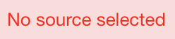](assets/image/message-no-source.png)

2. **Specify the template** (Block Sidebar Settings &rsaquo; Visual)
   - If a template has not been configured, *or* the selected template is not compatible with the configured source, the following message is displayed:

       [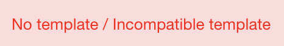](assets/image/message-no-template.png)

Content can come from multiple sources:

* [Dynamic](#dynamic)
* [Manual](#manual)
* [Popular Posts](#popular-posts)
* [Basic Loop](#basic-loop)
* [Remote WordPress](#remote-wordpress)
* [Taxonomies](#taxonomies)
* [Users](#users)

> ℹ️ Custom sources can [be created](#custom-sources) if none of the built-in types work for a particular use-case.

By default, only a few templates are provided:
* **Entry Grid** and **Entry List**: For use with "Dynamic", "Manual", "Popular Posts", and "Basic Loop" sources
* **Remote Items**: For use with the "Remote WordPress" source
* **User Cards**: For use with the "Users" source

> ℹ️ [Custom templates](#creating-a-template) can be created and will appear in the Template list for any source with a matching source type (from the `get_source_type` method).

## Templates

Templates determine how the curated content appears in the block. Additionally, Templates can have a variety of options depending on how they were built.

### Creating a Template

Create a new component in `templates` directory which extends the Template Component (Make sure to abstract the `Template` class).

> ℹ️ Automatically generated Templates appear in the Template selector dropdown within the Visual Panel of the Curated Content Block.

The Template creation process can be divided into three parts.

1. Definition
2. Markup &amp; Rendering
3. UI &amp; CSS

#### Definition

This part refers to actual template creation, by creating the following methods, a Template becomes available in the CCB block options.

>💡There are several methods that need to be extended to create a fully functional 
Template.

🔖 `get_name()` &ndash; _This method is responsible for defining the template name_.

```php
/**
 * Get the template name.
 *
 * @return string
 */
public function get_name() {
    return  __( 'My Custom Template', 'eutopia-theme' );
}
```

🔖 `get_classes( array $classes = [] )` &ndash; _This method allows adding custom classes to the block wrapper._

```php
/**
 * Get the template wrapper classes.
 *
 * @param string[] $classes The classes to add.
 *
 * @return string
 */
public function get_classes( array $classes = [] ) {
    $classes[] = 'my-custom-class';

    return parent::get_classes( $classes );
}
```

🔖 `get_controls()` &ndash; _Allows the definition of controls/options available with the Template._

There are several custom controls defined in the block, which can be used when creating a new Template:

1. Color
2. Help Text
3. Media
4. Post
5. Query
6. Source Type Select
7. Taxonomy

>💡Along with these, the default Gutenberg controls can also be used, except for control callbacks, which are not supported.

##### Custom Controls

In situations where the core Gutenberg controls and the existing Custom are not enough, additional custom controls can be created.

Custom controls are also a good idea if a configuration option is repeated multiple times (e.g. `color`). A custom control can be as simple (e.g. `help-text`) or as complex (e.g. `media`) as it needs to be.

> ℹ️ Review and inspect the built-in controls provided by the Curated Content Block to learn to build your own.

##### Data Source Type (Format)

The data available in the template will match the format specified in the `get_source_type` method. If the source type is `array` the data is guaranteed to be an array, but it may not be compatible with a particular Template.

When using the `array` type, it is necessary to verify the presence of array keys before attempting to use them. If more control over the data format is needed, consider using a custom source type.

🔖 `get_source_type()` &ndash; _Here is where the source type expected by the template is defined._

The following types are currently supported:

1. `wp_post`: &nbsp; `WP_Post` objects - This is the default source type used if one is not defined
2. `wp_user`: &nbsp; `WP_User` objects
3. `array`: &nbsp; Arbitrary array of values

```php
/**
 * Get the source type expected by the template.
 * 
 * @return string
 */
public function get_source_type() {
    return 'wp_user';
}
```

> ℹ️ Any string value can be returned by the `get_source_type` method, the only requirement is that is matches the value returned by a source's `get_source_type` method.

##### Reference

Check the implementation at `blocks/curated-content/php/components/templates/class-entry-grid.php#get_controls()` to get a good understanding of how to define the controls.

Entry Grid Controls:

[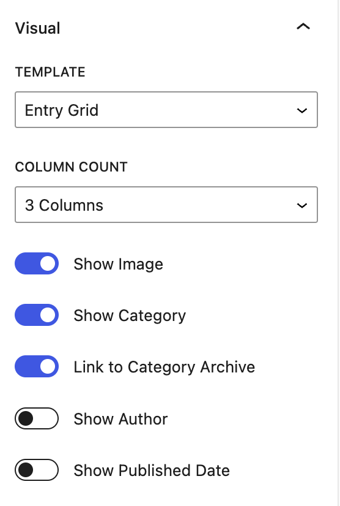](assets/image/template-entry-grid.png)

```php
/**
 * Get the controls.
 *
 * @return  array
 */
public function get_controls() {
    $controls = [
        // Using the default Notice control
        'notice_text' => [
            'label'               => __( 'Notice Demo', 'eutopia-theme' ),
            'control_type'        => 'Notice', // This is the default Notice control.
            'control_props'       => [ // In control_props, the default props provided by the control are defined.
                'status'         => 'success',
                'children'       => __( 'Sample notice text.', 'eutopia-theme' ),
                'is_dismissible' => false
            ],
    
            // Using the default SelectControl
            'select_control_demo' => [
                'label'         => __( 'Select Control', 'eutopia-theme' ),
                'default'       => 'DEFAULT_VALUE',
                'control_type'  => 'SelectControl',
                'control_props' => [
                    'options'   => [
                        [
                            'label' => __( 'Option 1', 'eutopia-theme' ),
                            'value' => 'value',
                        ],
                        [
                            'label' => __( 'Option 2', 'eutopia-theme' ),
                            'value' => 'value',
                        ]
                    ],
                ],
            ],
            
            // Using the custom control Color.
            'color_control'       => [ 
                'control_type'  => 'Color',
                'default'       => '#ffffff',
                // Put this control in the specified panel matching `TEMPLATE_ID`.
                'parent_panel'  => 'TEMPLATE_ID',
                'control_props' => [
                    'label'               =>  __( 'Select Color', 'eutopia-theme' )
                    'disableCustomColors' =>  true,
                    // Array of colors.
                    'colors'              => [
                        'hex_color1',
                        'hex_color2',
                    ],
                    'clearable'           =>  false,
                ],
            ],
        ],
    ];

    return $controls;
}
```

>💡There are components that do not use `value` to display the value, which means the `value_prop` needs to be defined manually. It defaults as value.

Let's consider an example of the `ColorPicker` control:

```php
'color_picker' => [
    'label'        => __( 'Color Picker', 'eutopia-theme' ),
    'control_type' => 'ColorPicker',
    'value_type'   => 'string',
    'color'        => '#000',
    'value_prop'   => 'color',
],
```

In a similar fashion, there are components that use `onSelect` instead of `onChange`. In that case the `change_prop` needs to be set as follows: `'change_prop' => 'onSelect'`

It is also possible to define the rendering order of controls by specifying the `control_priority` parameter, allowing the control to be positioned in a specific location (above or below other inspector controls):

```php
'show_media'          => [
	'label'            => __( 'Show Image', 'eutopia-theme' ),
	'default'          => false,
	'control_type'     => 'ToggleControl',
	'control_priority' => 1,
	'value_type'       => 'boolean',
	'value_prop'       => 'checked',
],
```
🔖 `get_panels()` &ndash; _Using this method new panels can be added to the CCB sidebar, Panels can be used to list controls defined by a template._

Entry Grid custom panel:

[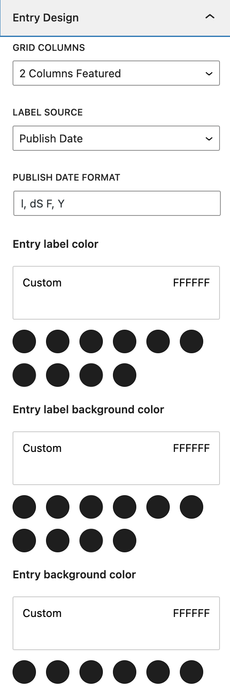](assets/image/entry-design-entry-grid.png)

```php
/**
 * Get the panels.
 *
 * @return array
 */
public function get_panels() {
    return [
        'TEMPLATE_ID' => [
            'title' => __( 'PANEL TITLE', 'eutopia-theme' ),
            'open'  => TRUE, // Boolean
        ],
    ];
}
```

#### Markup &amp; Rendering

The above methods are responsible for registering and configuring the Template. The other part involves rendering the template in the frontend and editor.

🔖 `render()` &ndash; _This method renders the HTML on frontend, the block attributes are available to use in the method._

> ⚠️ In most cases this method does not have to be changed. The block output can be controlled in a few other locations.

🔖 `do_item( $item, int $index )` &ndash; _This abstract method must be defined in a child template. It handles rendering a single curated content item._

In this method you will prepare item data for rendering, e.g. redefine the global `$post` object. You can output markup directly in this method or by using `get_template_part`.

```php
/**
 * Do a single item. 
 * Walker supports arbitrary collections of data, like: 
 * content types, terms, users, etc.
 *
 * @param mixed $item  The item to do.
 * @param int   $index Current index.
 */
public function do_item( $item, int $index ) {
    global $post;

    $post = $item; // phpcs:ignore WordPress.WP.GlobalVariablesOverride.Prohibited

    get_template_part(
        'template-parts/list-entry/base',
        null,
        $this->get_attributes(),
    );
}
```

🔖 `before_items()` &ndash; _This allows rendering HTML markup above the curated content items._

In this method you can `get_template_part` or output directly arbitrary markup that should be rendered above the curated content items. This will typically be an opening tag of a wrapper element.

🔖 `after_items()` &ndash; _This allows rendering HTML markup below the curated content items._

In this method you can `get_template_part` or output directly arbitrary markup that should be rendered below the curated content items. This will typically be a closing tag of a wrapper element.

#### UI & CSS

In this part we have to create a new SCSS file and add the required styles specific to the Template markup.

It is best to share styles between the regular theme templates and curated content block templates. In such a situation, you will keep the relevant SCSS partials in the `css` directory of the theme. The templates used by CCB will then reference the common classnames defined in the theme.

In rather rare situations when the Curated Content Block template is very specific and you don't anticipate it being used anywhere else, you can place the stylesheets in the `blocks/curated-content/css` directory. Be sure to import the styles in the `curated-content/styles.scss` file so they are included correctly.

## Source

[Top](#curated-content-block)

The source fetches and prepares the curated content.

### Dynamic

Dynamically sourced content is obtained from the site's local WordPress database. In order to use the Dynamic source you need to specify serveral options in the block's settings sidebar.

[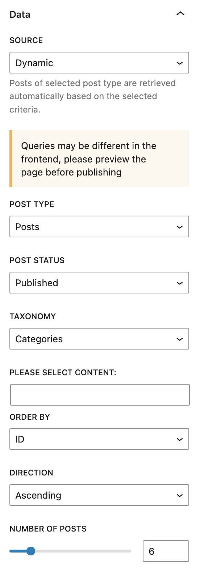](assets/image/source-dynamic.png)

* **Post Type**: The type of content to use.
  * Default Options:
    * Posts (default)
    * Pages
    * Media
  * Custom Post Types will become available once they have been registered.
* **Post Status**: The post_status of the content to include.
  * Default Options
    * Published (default)
    * Inherit
    * Pending Review
    * Private
* **Taxonomy**: The taxonomy used to filter content.
  * Default Options:
    * none (default)
    * Categories
    * Tags
    * Navigation Menus
    * Link Categories
    * Formats
    * Themes
    * Template Part Areas
  * Custom taxonomies will become available once they have been registered.
* **Please Select Content**: (Only available if "Taxonomy" is not "none") The Taxonomy Term(s) used to filter the content.
  * Start typing the term to search available terms in the selected taxonomy.
  * Multiple terms can be selected.
* **Order By**: The post field used to sort the content.
  * Default Options
    * **none**: Content will not be sorted
    * **ID**: Content will be sorted by Post ID
    * **author**: Content will be sorted by Author (TBD name or id?)
    * **title**: Sort by the post_title
    * **name**: Sort by the post_name or slug
    * **date**: Sort by post created date
    * **modified**: Sort by post modified date
    * **rand**: Sort content randomly
    * **comment_count**: Sort by the number of comments on a post.
* **Direction**: (Only available if "Order By" is not "none") The direction in which to sort the content. Options include:
  * Ascending (default)
  * Descending
* **Number of Posts**: The number of posts to display in the block (default 6).
  * Change the value using the slider or by entering a specific number.

### Dynamic Query Exclusions

The [Dynamic Query Exclusions Component](php/components/class-acf-options-page-dynamic-query-exclusions.php) allows us to define certain terms of the Metadata taxonomy, and posts containing those terms will be excluded from the [CCB Dynamic queries](blocks/curated-content/php/components/sources/class-dynamic.php) sitewide. This is particularly useful for hiding certain posts from CCB altogether. To extend the Metadata Taxonomy to additional post types, update the list of post types specified when the taxonomy is [registered](php/components/class-acf-options-page-dynamic-query-exclusions.php).

*Example:* We can avoid sponsored content being offered as related content in inappropriate circumstances, by blacklisting posts with `sponsored` term from `{SITE_DOMAIN}/wp-admin/options-general.php?page=theme-options`, and assigning the term to all sponsored posts.

### Manual

To manually curate the content displayed in the block the Post Type they should be pulled from must be specified.

[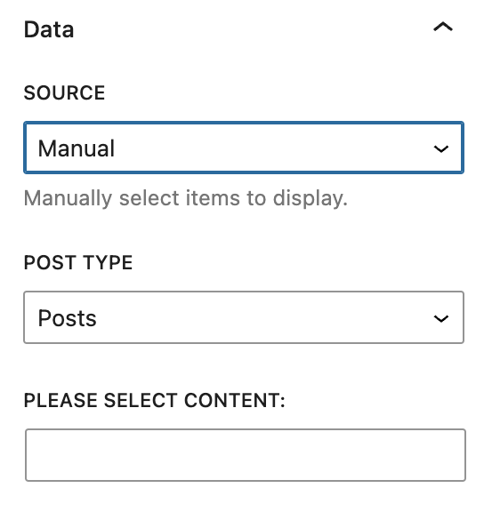](assets/image/source-manual.png)

* **Post Type**: The type of content to use.
  * Default Options:
    * Posts (default)
    * Pages
    * Media
  * Custom Post Types will become available once they have been registered.
* **Please Select Content**: Specify the content to display in the block.
  * Start typing the title of a post and select it from the list.
  * Multiple posts can be specified.
  * Only the selected items will be displayed in the block, there is no need to specify the number of posts to display.

### Popular Posts

Posts will be selected based on their popularity on the site either by comment count or views (requires JetPack). This source only supports the `post` post type. This source is an extension of the `Basic Loop` source.

[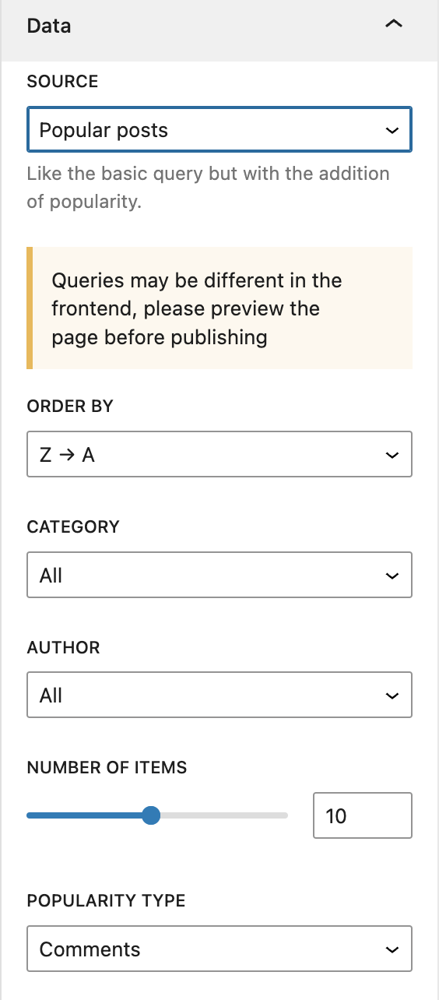](assets/image/source-popular.png)

* **Order By**: The order in which the posts will be sorted.
  * Options
    * Newest to Oldest: Order posts by post date newest to oldest
    * Oldest to Newest: Order posts by post date oldest to newest
    * A -> Z (default): Order posts alphabetically by post_title
    * Z -> A: Order posts in reverse alphabetical order by post_title
* **Category**: The category from which to select posts
  * Default Options
    * All (default)
    * Uncategorized
  * Additional categories will become available once they are created.
* **Author**: Limit posts to a specified Author.
  * Default Options
    * All (default)
    * admin (or the username selected for the first user on the site)
  * Additional authors will become available as users are added to the site.
* **Number of Items**: The number of posts to display (default 10).
  * Change the value using the slider or by entering a specific number.
* **Popularity Type**: Specify how "popular" posts are determined.
  * Default Options
    * Comments (default): The posts with the most comments will be displayed.
      * Comments must be enabled for this option to work.
    * Views (required JetPack): The posts with the most views will be displayed

### Basic Loop

Posts will be selected based on a basic post query.

[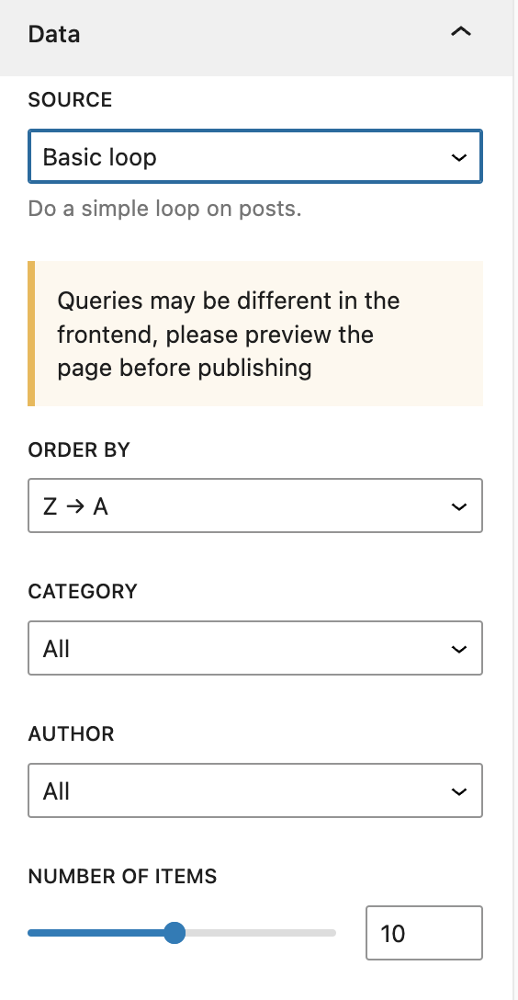](assets/image/source-basic-loop.png)

* **Order By**: The order in which the posts will be sorted.
  * Options
    * **Newest to Oldest**: Order posts by post date newest to oldest
    * **Oldest to Newest**: Order posts by post date oldest to newest
    * **A -> Z (default)**: Order posts alphabetically by post_title
    * **Z -> A**: Order posts in reverse alphabetical order by post_title
* **Category**: The category from which to select posts
  * Default Options
    * All (default)
    * Uncategorized
  * Additional categories will become available once they are created.
* **Author**: Limit posts to a specified Author.
  * Default Options
    * All (default)
    * admin (or the username selected for the first user on the site)
  * Additional authors will become available as users are added to the site.
* Number of Items: The number of posts to display (default 10).
  * Change the value using the slider or by entering a specific number.

### Remote WordPress

Remotely sourced content is sourced from external WordPress sites. In order to use the Remote WordPress you need to specify serveral options in the block's settings sidebar.

[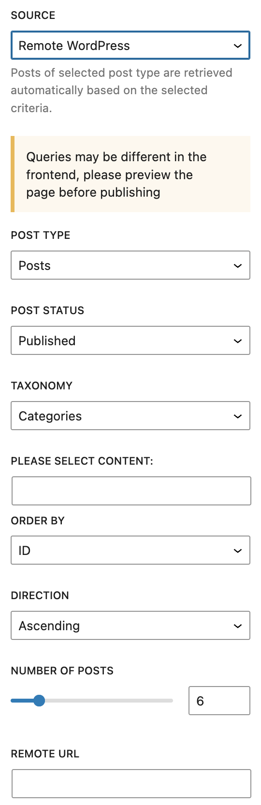](assets/image/source-remote-wp.png)

* **Post Type**: The type of content to use.
  * Default Options:
    * Posts (default)
    * Pages
    * Media
  * Custom Post Types will become available once they have been registered.
* **Post Status**: The post_status of the content to include.
  * Default Options
    * Published (default)
    * Inherit
    * Pending Review
    * Private
* **Taxonomy**: The taxonomy used to filter content.
  * Default Options:
    * none
    * Categories (default)
    * Tags
    * Navigation Menus
    * Link Categories
    * Formats
    * Themes
    * Template Part Areas
  * Custom taxonomies will become available once they have been registered.
* **Please Select Content**: (Only available if "Taxonomy" is not "none") The Taxonomy Term(s) used to filter the content.
  * Start typing the term to search available terms in the selected taxonomy.
  * Multiple terms can be selected.
* **Order By**: The post field used to sort the content.
  * Default Options
    * **none**: Content will not be sorted
    * **ID**: Content will be sorted by Post ID
    * **author**: Content will be sorted by Author (TBD name or id?)
    * **title**: Sort by the post_title
    * **name**: Sort by the post_name or slug
    * **date**: Sort by post created date
    * **modified**: Sort by post modified date
    * **rand**: Sort content randomly
    * **comment_count**: Sort by the number of comments on a post.
* **Direction**: (Only available if "Order By" is not "none") The direction in which to sort the content. Options include:
  * Ascending (default)
  * Descending
* **Number of Posts**: The number of posts to display in the block (default 6).
  * Change the value using the slider or by entering a specific number.
* **Remote URL**: The URL of the remote WordPress site the content from which the content is to be sourced.

### Taxonomies

Will display a list of available taxonomy terms. Or a curated list of selected taxonomy terms.

[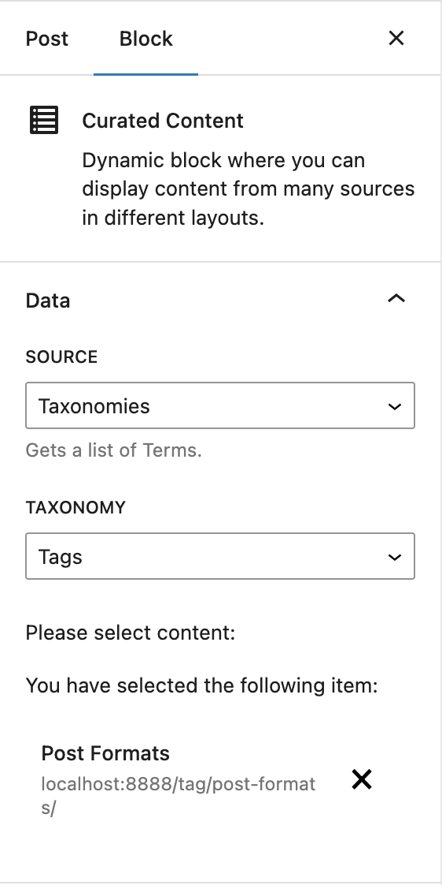](assets/image/source-taxonomies.png)

* Taxonomy
  * Default Options
    * Categories
    * Tags
  * *Additional taxonomies will become available once they have been registered on the site.*

### Users

Will display a list of users based on the selected role. This does not display the posts authored by the users matching the selected role.

[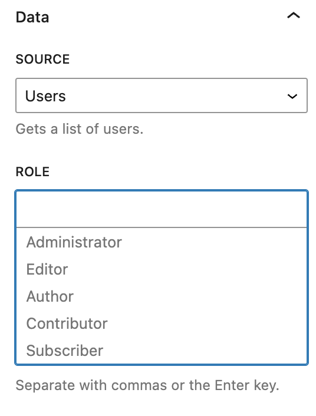](assets/image/source-users.png)

* **Role**
  * Default Options
    * Administrator
    * Editor
    * Author
    * Contributor
    * Subscriber
  * Additional roles will become available once they have been registered on the site.
  * Multiple roles can be selected

### Custom Sources

[Top](#curated-content-block)

#### Planning

The following checklist should be used to plan out the custom source.

- [ ] Determine what data needs to be returned by the source
  - [ ] Identify Post Type(s)
  - [ ] Identify Post Data
  - [ ] Identify any Post Meta
  - [ ] Identify any Taxonomy / Terms
  - [ ] Identify any Data from custom tables
- [ ] Map out where the data is coming from
- [ ] Determine Source configuration settings
- [ ] Map out which control will be used for each setting
  - [ ] Determine if any custom controls are required
- [ ] Determine the data return format (`wp_post`, `wp_user`, `array`, etc.)
- [ ] Determine which template will be used to display the data
  - [ ] Determine if a custom template is required

#### Example

A custom post type `lender` is related to a custom table containing mortgage rates. A custom source is needed to display a list of lenders and associated mortgage rates. The data should be displayed in an HTML table on the page.

The configuration of the custom source will look like this when completed:

[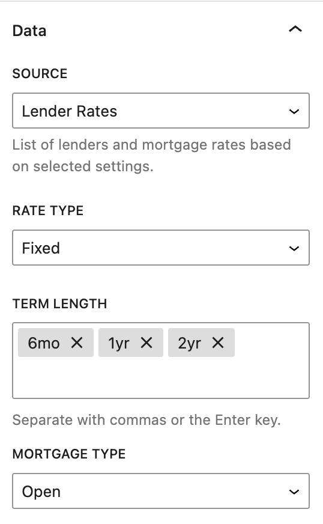](assets/image/example-source-lender-rates.png)

Custom table `wp_mortgage_rates`

| Field         | Data Type     |
|---------------|---------------|
| lender_id     | int (post_id) |
| mortgage_rate | string        |
| rate_type     | string        |
| term_length   | string        |
| mortgage_type | string        |

* **Data to be displayed**
  * Post type
    * `lender`
  * Post data
    * `post_title`
  * Post meta
    * none
  * Taxonomy / Terms
    * none
  * Custom table data
    * `mortgage_rate`
    * `term_length`
* **Data Map**
  * `post_title` &rarr; `wp_posts.post_title`
  * `mortgage_rate` &rarr; `wp_mortgage_rates.mortgage_rate`
  * `term_length`  &rarr; `wp_mortgage_rates.term_length`
* **Settings / Options**
  * Rate type
  * Term Length
  * Mortgage Type
* **Setting Controls**
  * **Rate Type - SelectControl**
    * Options
      * Fixed
      * Variable
  * **Term Length - FormTokenControl**
    * Suggestions
      * 6mo
      * 1yr
      * 2yr
      * 3yr
      * 4yr
      * 5yr
      * variable
  * **Mortgage Type - SelectControl**
    * Options
      * Open
      * Closed
* **Data return format**
  * Array
    * lender
    * Array
      * mortgage_rate
      * rate_type
      * term_length
* **Template**
  * Custom

Having the source planned out, it is now time to build it. This particular source does not require a [custom control](#custom-controls) or a custom source type, however, instructions for how to build these components are discussed throughout this document.

>💡The example source we are building *does* require a custom template. Please refer to the [Creating a Template](#creating-a-template) section to learn how to create custom templates.

This custom source only requires a new PHP class to be created. No JavaScript is required. While the components of the source class are being added, comments will be ommitted. However, any necessary comments must be added to ensure coding standards are followed.

A PHP class file, `class-lender-rates.php`, will be created in the `curated-content/php/components/sources` directory.

>💡The class file must declare the correct namespace in order for the source to be loaded correctly.

```php
namespace Eutopia_Theme\Curated_Content\Components\Sources;
```

The class being created will extend the abstract `Source` class. Add the appropriate `use` statement so the base class can be included:

```php
use Eutopia_Theme\Curated_Content\Components\Source;
```

Next, start the class:

```php
class Lender_Rates extends Source {
}
```

> ℹ️ Even though an abstract class is being extended, there are no required methods to extend. In this case, this source will not be useful without extending a few built in methods.

The `get_name()` method is used to determine the name of the source appearing in the Source selection. If this method is omitted, the name of the class will be used. It is also a good idea to add this method, this way the name of the source can be translated.

```php
public function get_name() {
    return __( 'Lender Rates', 'eutopia-theme' );
}
```

The next method to add is `get_help` which specifies the help text displayed when the source is selected.

```php
public function get_help() {
    return __( 'List of lenders and mortgage rates based on selected settings.', 'eutopia-theme' );
}
```

Next, the `get_source_type()` method will be added to specify the type of data the source will return and should match source type of a [custom template](#creating-a-template) otherwise the data cannot be displayed.

By default, the following source types are supported:

1. `wp_post`: &nbsp; `WP_Post` objects - This is the default source type.
2. `wp_user`: &nbsp; `WP_User` objects
3. `array`: &nbsp; Arbitrary arrays of data.

> ℹ️ Since an `array` can contain anything, it may be appropriate to use a custom source type.

To create a custom source type, simply return a unique string in this method, such as `lender_rate` and ensure there is a template that expects the same source type.

When using a custom source type, make sure to document the shape of the data so other developers creating custom templates know what to expect.

```php
public function get_source_type() {
    return 'array';
}
```

Before getting into fetching the data, the `get_controls()` method will be defined to allow for the configuration of the source.

```php
public function get_controls() {
    return [
        'rate_type'     => [
            'label'         => __( 'Rate Type', 'eutopia-theme' ),
            'default'       => 'fixed',
            'control_type'  => 'SelectControl',
            'control_props' => [
                'options' => [
                    [
                        'label' => __( 'Fixed', 'eutopia-theme' ),
                        'value' => 'fixed',
                    ],
                    [
                        'label' => __( 'Variable', 'eutopia-theme' ),
                        'value' => 'variable',
                    ],
                ],
            ], 
        ],
        'term_length'   => [
            'label'         => __( 'Term Length', 'eutopia-theme' ),
            'default'       => [],
            'value_type'    => 'array',
            'control_type'  => 'FormTokenField',
            'control_props' => [
                'suggestions'  => [
                    '6mo',
                    '1yr',
                    '2yr',
                    '3yr',
                    '4yr',
                    '5yr',
                    'variable',
                ],
                'experimental' => [
                    '__experimentalExpandOnFocus',
                    '__experimentalAutoSelectFirstMatch',
                ],
            ], 
        ],
        'mortgage_type' => [
            'label'         => __( 'Mortgage Type', 'eutopia-theme' ),
            'default'       => 'open',
            'control_type'  => 'SelectControl',
            'control_props' => [
                'options' => [
                    [
                        'label' => __( 'Open', 'eutopia-theme' ),
                        'value' => 'open',
                    ],
                    [
                        'label' => __( 'Closed', 'eutopia-theme' ),
                        'value' => 'closed',
                    ],
                ],
            ], 
        ],
    ];
}
```

Prepare the attributes to ensure all items are present and contain usable values. This is a very basic implementation. For production, it may be necessary to ensure the attribute value matches the `value_type` control .

```php
protected function prep_attributes( $attributes ) {
    $keys = array_keys( $this->get_controls() );
    
    foreach ( $keys as $key ) {
        if ( ! isset( $attributes[ $key ] ) ) {
            $attributes[ $key ] = '';
        }
    }
    
    // Make sure the term length is an array.
    if ( ! is_array( $attributes['term_length'] ) ) {
        $attributes['term_length'] = (array) $attributes['term_length'];
    }

    return $attributes;
}
```

With the source now being able to be configured and attributes already prepared, it is time to get the items to return with this source. For simplicity, this example assumes there is a Model (`Mortgage_Rates_Model`) with a static method `get_rates()` that takes the `rate_type`, `mortgage_type`, and `term_length` attributes as parameters and returns the data needed. A Model is not required, but recommended. However, there is nothing to prevent queries from being run directly in this method.

```php
public function get_items( array $attributes ) {
    global $wpdb;
    
    $res = Mortgage_Rate_Model::get_rates(
        $attributes['rate_type'],
        $attributes['mortgage_type'],
        $attributes['term_length']
    );

    if ( empty( $res ) ) {
        return [];
    }
    
    // Organize the data in the format the template is expecting.
    $data = [];
    foreach ( $res as $row ) {
        $slug = $row['lender_slug'];
        if ( ! isset( $data[ $slug ] ) ) {
            $data[ $slug ] = [
                'lender' => $row['lender'],
                'rates'  => [],
            ];
        }
        $data[ $slug ]['rates'][] = [
            'mortgage_rate' => $row['mortgage_rate'],
            'term_length'   => $row['term_length'],
        ];
    }
    
    return $data;
}
```

This next method is not required, but it can be used to ensure the data being returned by this source is properly sized and formatted. Here we simply return the items to avoid the modifications done by the default method.

```php
protected function prep_items( $items, $item_limit ) {
    return $items;
}
```

Once the class is saved and the editor is refreshed, this custom source will be available in the source selector. Since this example does not include the `Mortgage_Rate_Model`, the custom post type definition, or the custom table definition, the class cannot be used as is.

A gist of a working version of this custom source is available [here](https://gist.github.com/surrealwebs/2f8b3f6371d44225b559012e3774b9dd). This source is not ready for production. Usage of the `get_items()` method has been overly simplified and a custom template would be required.
